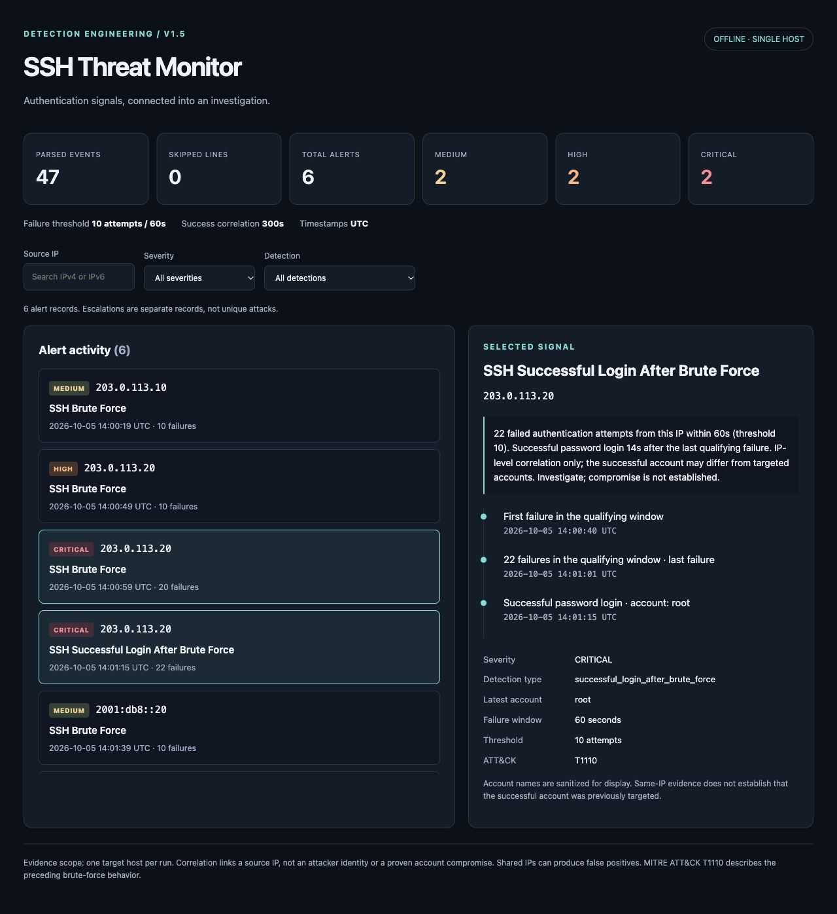

# V1.5 validation

Validated locally on 2026-10-08 using Python 3.14.4.

## Automated checks

```bash
PYTHONPATH=src python3 -m unittest discover -s tests -q
git diff --check
```

**82 tests passed**, including all 46 original V1 tests. Coverage includes correlation boundaries (including one microsecond past expiry), episode deduplication, different accounts, IPv4/IPv6, password/publickey, expiry and capacity recovery, immutable evidence, schema v2, escaped hostile HTML, output aliases, exclusive atomic publication, and HTML truncation with complete JSONL output.

The existing GitHub Actions matrix remains Python 3.11–3.14. Only Python 3.14.4 was executed in this local session; other interpreter versions require CI.

## Reproducible demo expectations

Use the three-command demo in the README, with new output filenames on reruns.

| Input fixture | Parsed | Skipped | Emitted alerts | Correlation alerts |
| --- | ---: | ---: | ---: | ---: |
| `normal_auth.log` | 4 | 0 | 0 | 0 |
| `brute_force.log` | 13 | 0 | 1 MEDIUM | 0 |
| `successful_login_after_attack.log` | 16 | 0 | 2 HIGH | 1 |
| `different_account_after_attack.log` | 16 | 0 | 2 HIGH | 1, account `bob` |
| `expired_success_after_attack.log` | 16 | 0 | 1 HIGH | 0 |
| `portfolio_demo.log` | 47 | 0 | 6: 2 MEDIUM / 2 HIGH / 2 CRITICAL | 2 |

## Browser checks

The generated reports were checked in the Codex in-app browser through a temporary loopback HTTP server restricted to the synthetic `reports/` directory. The server and temporary browser tab were closed after verification. Browser automation does not allow direct `file:` navigation, so opening the artifact by file URL was not automated; all styles, scripts, and data are embedded with no external resources.

- Desktop breakpoint: 1280 × 960, two investigation columns, no horizontal overflow.
- Mobile breakpoint: 390 × 844, one investigation column, two summary columns, no horizontal overflow.
- Normal, brute-force, and successful-login reports showed 0, 1, and 2 alert records respectively.
- Severity `CRITICAL` reduced the portfolio activity to two records while preserving the full-run counters.
- Combined successful-login + IPv6 filters produced one record, with a publickey login for `bob` and a six-second interval.
- An unmatched IP search showed an empty list and empty evidence state.
- Selecting the CRITICAL successful-login record showed 22 failures, the last failure at 14:01:01 UTC, and a successful root password login at 14:01:15 UTC.
- A synthetic username containing `</script>` appeared literally as text. The DOM contained zero image elements and only the application script; no console errors were captured.

Screenshots below use documentation-reserved addresses and synthetic account names only.



[Mobile report screenshot](images/v1.5-report-mobile.jpg)

## Limits to communicate

One target host per run; correlation establishes only same-IP activity. The successful account is not claimed to have been targeted or compromised. HTML keeps the first 1,000 alert details; full-run counters remain exact and JSONL includes all alerts. JSONL may be partial on error; HTML is only published after a successful run. Existing outputs are never replaced.
